# gofyrAdmin

> **Embeddable, Full-Stack Go Admin Panel, Media Manager, and Interactive API Workbench for Gin & GORM applications.**
> Combines the best parts of **Django Admin**, **Swagger/Scalar**, and **Laravel Artisan CLI** into a single drop-in package with an embedded **Svelte 5** dark-mode SPA.

---

## Highlights

- ⚡ **Zero-Config Drop-in**: Mount onto any existing Gin application with just 3 lines of code.
- 🚀 **Instant Project Scaffolder (`gofyr create`)**: Bootstrap a complete, runnable Go + Gin + GORM application pre-configured with gofyrAdmin via interactive wizard or CLI flags.
- 🗄️ **Multi-Datasource GORM Engine**: Seamlessly connect and switch between **SQLite** (pure-Go, zero-CGO), **PostgreSQL**, and **MySQL** databases in real-time.
- 🏷️ **GORM Reflection & Custom Struct Tags**: Automatic UI generation from model structs with custom tags like `gofyr:"type:image,disk:s3,folder:avatars"`, `gofyr:"type:gallery"`, `gofyr:"searchable"`, and `gofyr:"readonly"`.
- 🛠️ **In-UI Dynamic Model Creation**: Create new GORM models and auto-migrate database tables directly from within the web interface without touching code.
- 🧪 **Interactive API Workbench & Dynamic Routes**: Introspects host Gin routes and allows creating new custom routes and testing endpoints with an in-memory, zero-latency HTTP test runner and JSON payload editor.
- 🎨 **Dark Mode with Lavender Accents & Per-User Theme Customization**: Elegant dark mode by default with lavender accents, customizable per user (choose between Lavender, Violet, Indigo, Rose, Emerald, Amber, or Cyan, plus Comfortable or Compact density).
- 📱 **Mobile-Friendly & Responsive**: Fully responsive layout featuring a slide-in navigation drawer, responsive data tables, and mobile-optimized API Workbench.
- 🔐 **Two-Stage TOTP MFA Security**: Built-in 6-digit TOTP authentication (`pquerna/otp`), QR code provisioning wizard, and 8 single-use emergency backup recovery codes.
- 📦 **Pluggable Media Storage**: Production-ready drivers for **Local Disk** and **S3-compatible object storage** (AWS S3, Cloudflare R2, MinIO, DigitalOcean Spaces) with live upload progress and lightbox previews.
- 💻 **Modern Svelte 5 SPA**: Built with Svelte 5 Runes (`$state`, `$derived`, `$effect`), Tailwind CSS, and embedded directly into the Go binary via `//go:embed`.

---

## Screenshots & UI Tour

Explore the dark lavender user interface across desktop and mobile form factors.

### 🖥️ Desktop Web Views (1440 × 900)

#### 1. Dashboard & GORM Model Explorer
Full-featured GORM data table with column sorting, real-time search, image thumbnails, pagination, and bulk deletion actions.
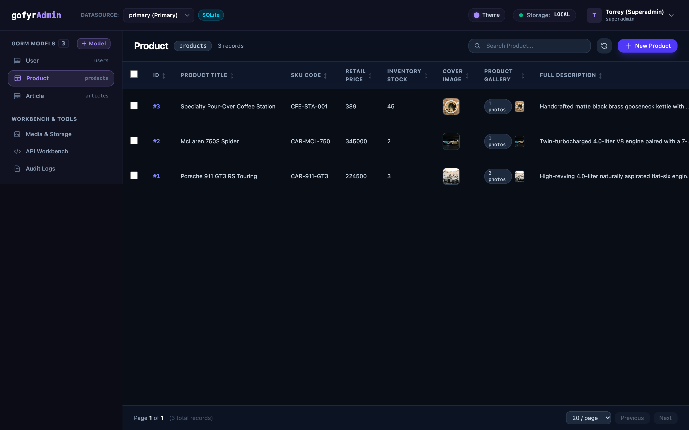

#### 2. Dynamic In-UI GORM Model Creator (`+ Model`)
Create new GORM models on the fly, define fields, types, and struct tags, and auto-migrate database tables without leaving the browser.
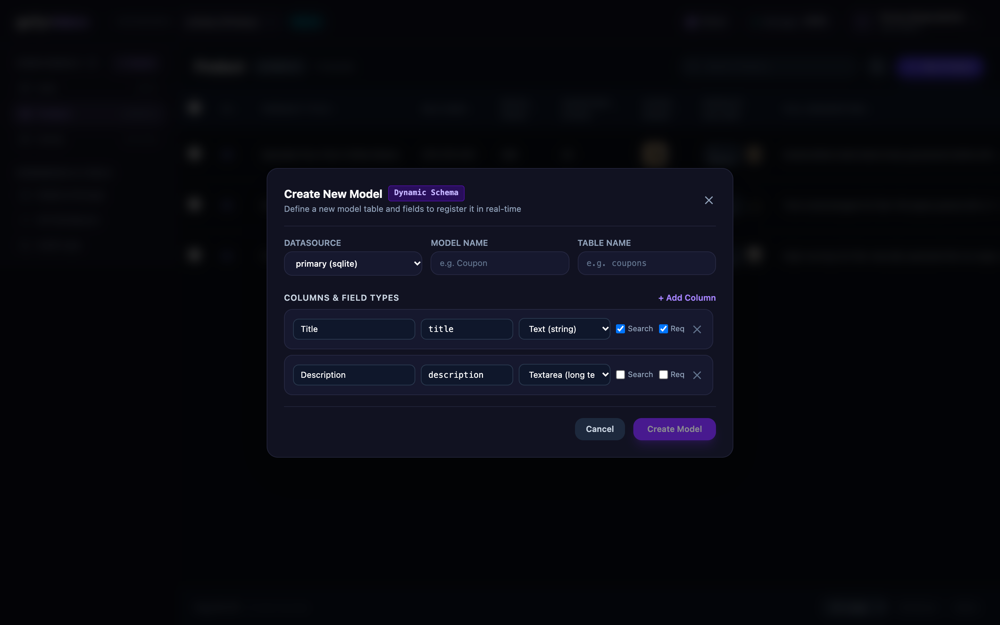

#### 3. Appearance & Theme Customizer
Per-user UI customization with 7 accent color palettes (Lavender, Violet, Indigo, Rose, Emerald, Amber, Cyan) and display density toggle (Comfortable vs Compact).
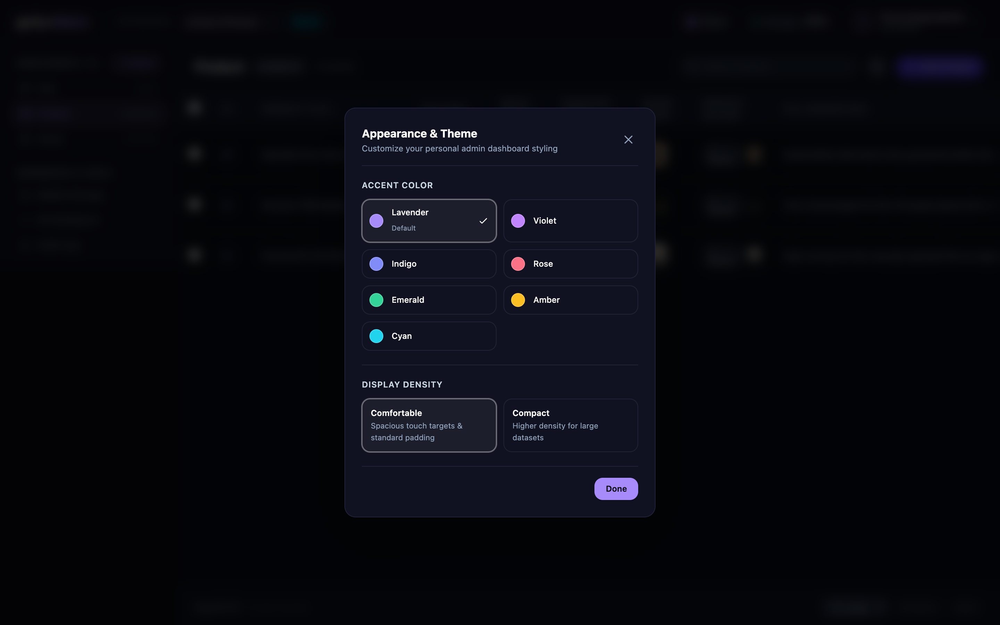

#### 4. Interactive API Workbench & Route Runner
Introspects host Gin routes, executes zero-latency in-memory HTTP calls, and displays structured JSON responses with status badges.
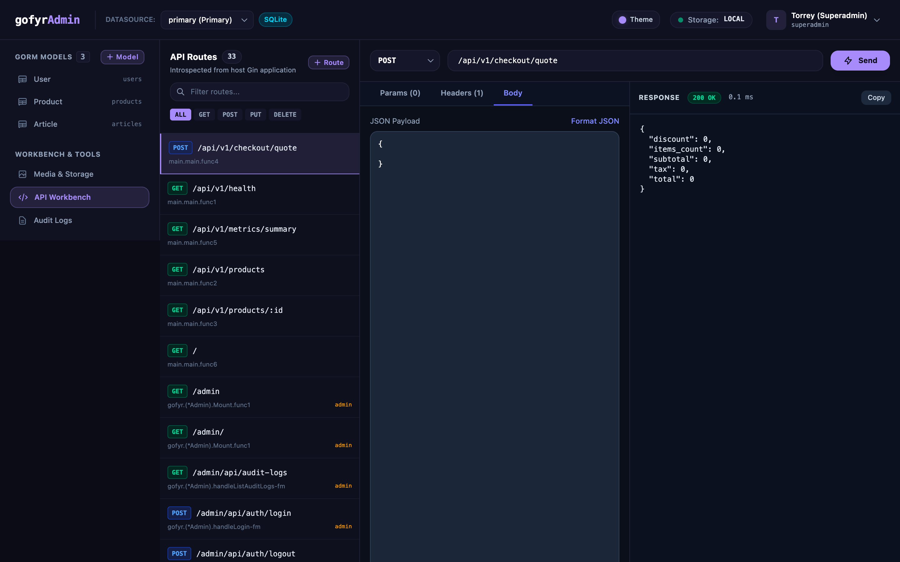

#### 5. Dynamic In-UI Route Creator (`+ Route`)
Mock new API endpoints with custom methods, status codes, and mock JSON response bodies right from the API Workbench.
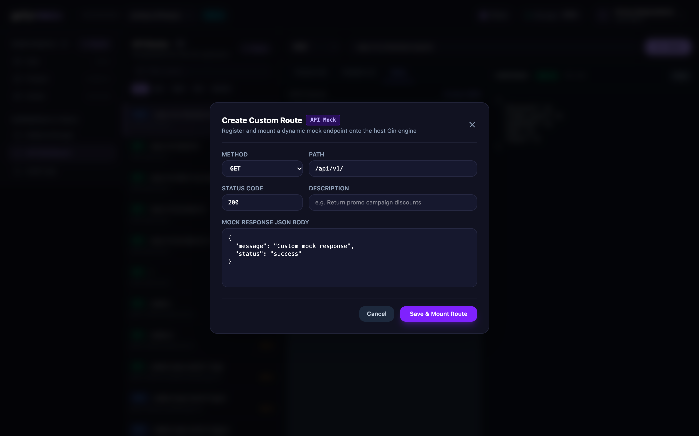

#### 6. Media Library & Storage Backend
Multi-backend asset management supporting Local Disk and S3/MinIO with drag-and-drop file uploads, image thumbnails, and lightbox previews.
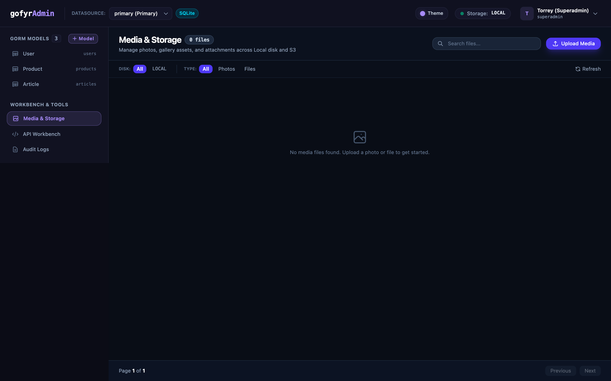

#### 7. Security Audit Logs Trail
Complete mutation and authentication audit trail recording actions, resource targets, actors, client IP addresses, and timestamps.
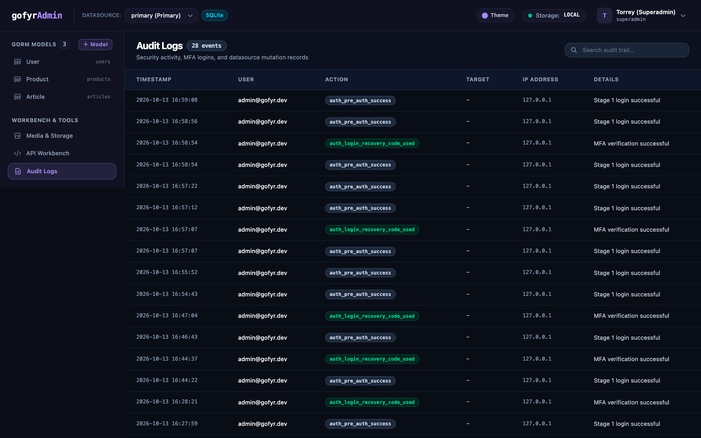

#### 8. Clean Typographic Authentication & 2FA Security
Zero-icon typographic branding with segmented 6-digit TOTP verification and emergency single-use backup recovery codes.

| Login Screen | 2FA / OTP Verification |
|:---:|:---:|
| 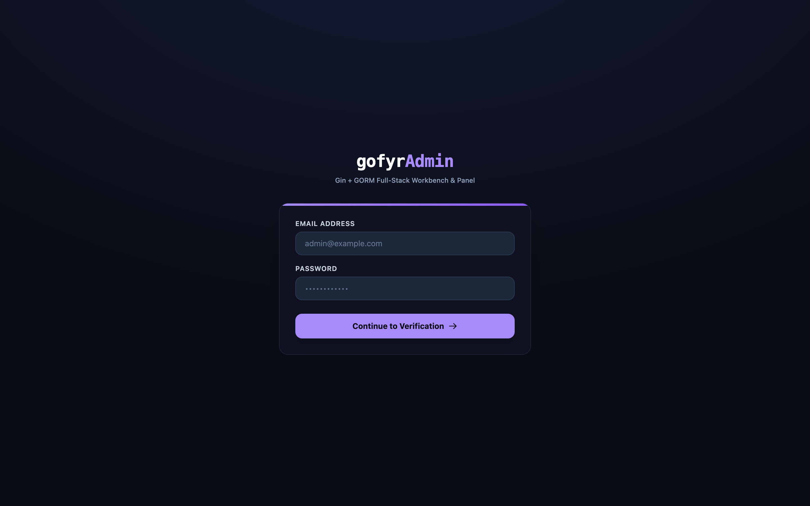 | 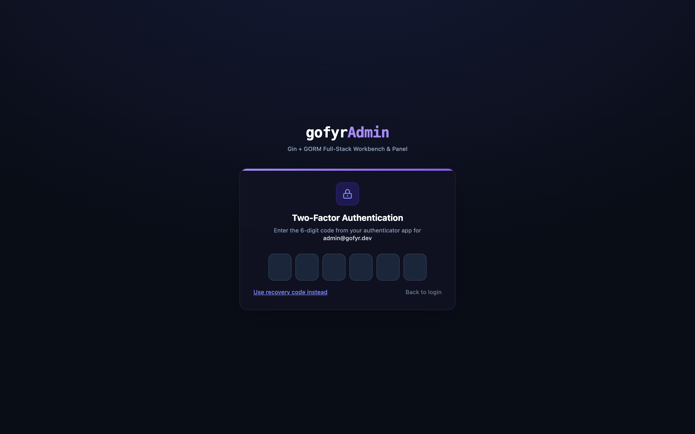 |

---

### 📱 Mobile Web Views (390 × 844)

Built from the ground up for mobile usability, featuring an off-canvas slide-out drawer, touch-friendly tap targets, and responsive tables.

| Slide-in Navigation Drawer | Model Explorer Table | Appearance & Theme Picker |
|:---:|:---:|:---:|
| 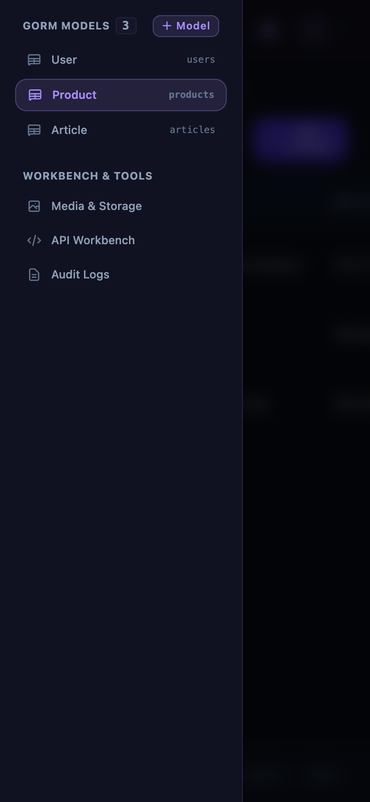 | 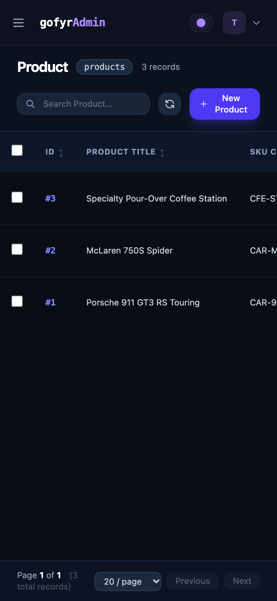 | 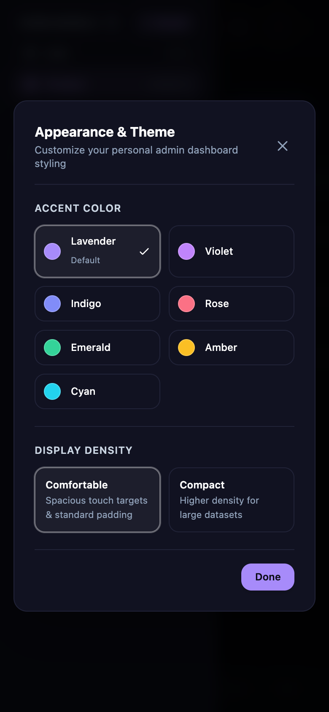 |

| In-UI Model Creator | API Workbench Runner | Media Library & Storage |
|:---:|:---:|:---:|
| 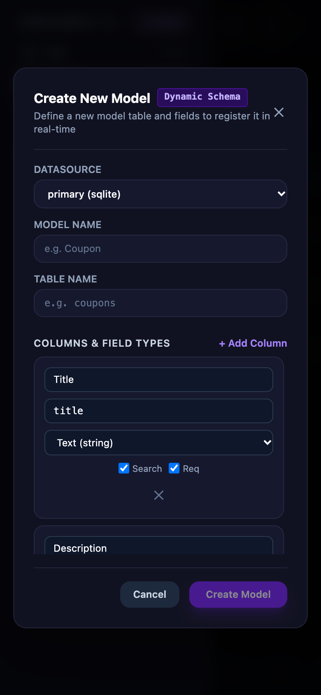 | 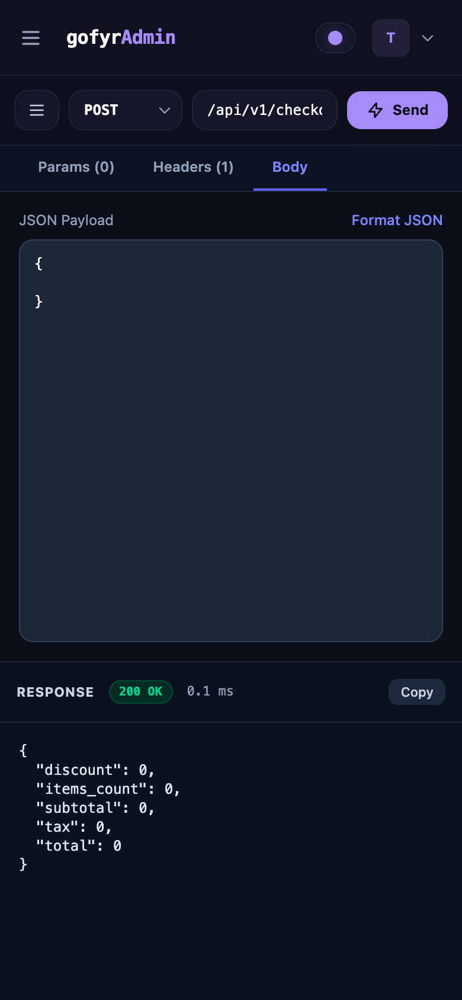 | 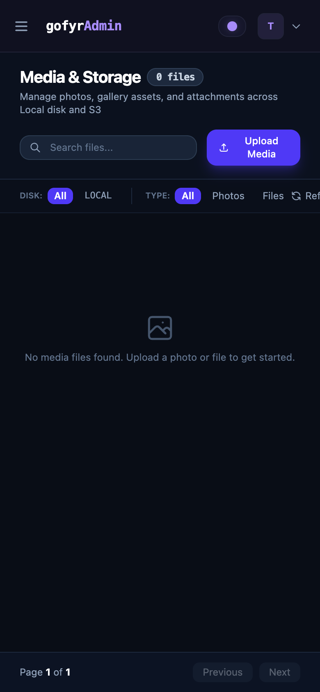 |

| Security Audit Logs | Mobile Login Screen | 2FA / OTP Verification |
|:---:|:---:|:---:|
| 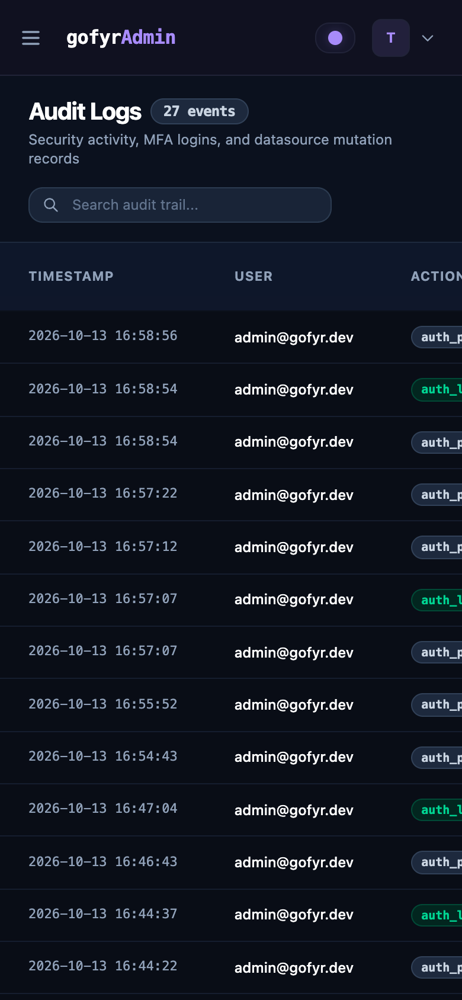 | 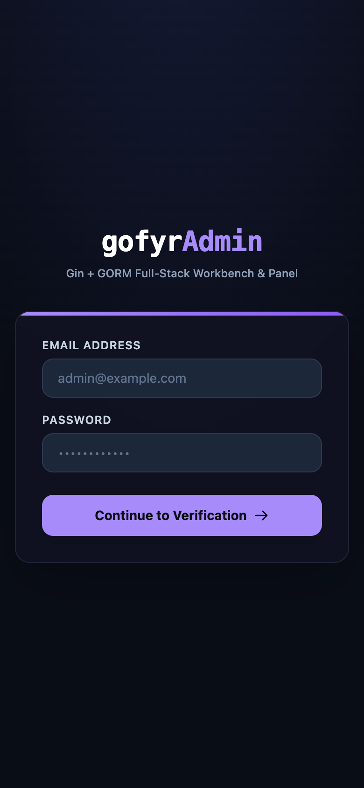 | 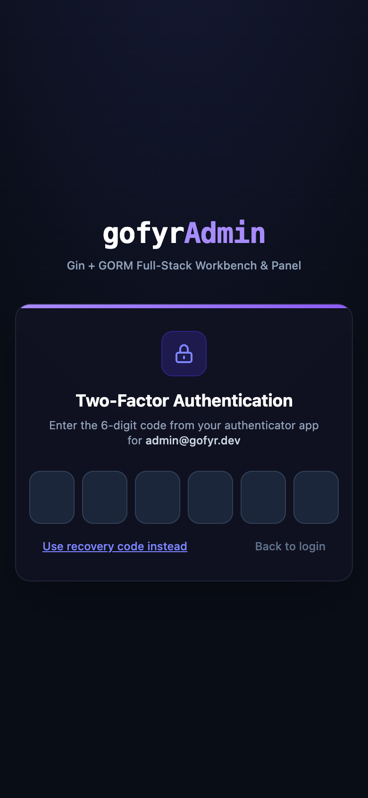 |

---

## Architecture & Layout

```
gofyr_admin/
├── pkg/gofyr/               # Core drop-in gofyrAdmin Go package
│   ├── gofyr.go             # Admin engine (New, Mount, AddDatasource, RegisterModel)
│   ├── config.go            # Configuration defaults and token settings
│   ├── datasource.go        # Multi-datasource registry, dialect detector, ping probe
│   ├── schema.go            # GORM reflection, tag parser, and dynamic model creation
│   ├── crud.go              # Universal dynamic CRUD engine with pagination & search
│   ├── auth.go              # JWT session management and bcrypt password security
│   ├── mfa.go               # TOTP generator, QR encoder, and recovery code verification
│   ├── audit.go             # Persistent audit logging for security and mutations
│   ├── media.go             # Media upload handler and file catalog
│   ├── routes.go            # Gin route mounting and embedded SPA asset server
│   ├── workbench.go         # Route introspection, custom routes, and test runner
│   ├── storage/             # Pluggable storage system
│   │   ├── driver.go        # Driver interface (Upload, Delete, GetURL)
│   │   ├── local.go         # Local disk storage driver with MIME validation
│   │   └── s3.go            # AWS S3 driver (MinIO, R2, DO Spaces, Presigned URLs)
│   └── ui/                  # Embedded frontend distribution
│       ├── embed.go         # //go:embed all:dist
│       └── dist/            # Compiled production Svelte 5 SPA
├── cmd/gofyr/               # Dedicated CLI tool built with spf13/cobra
│   ├── main.go              # Root command & command registration
│   ├── create.go            # gofyr create <project-name> scaffolder
│   ├── init.go              # gofyr init config scaffolder
│   ├── migrate.go           # Database migrations runner
│   ├── user.go              # user:create and user:reset-mfa with ASCII QR
│   ├── ds.go                # ds:ping multi-datasource health check
│   ├── storage.go           # storage:test upload/delete validation
│   └── routes.go            # routes:list Gin endpoint inspector
├── web/                     # Svelte 5 SPA source code
│   ├── src/
│   │   ├── App.svelte       # Root reactive shell with theme & drawer state
│   │   ├── lib/
│   │   │   ├── api.ts       # Type-safe API client
│   │   │   ├── theme.ts     # User appearance preferences & accent palettes
│   │   │   ├── types.ts     # TypeScript schema contracts
│   │   │   └── components/  # Modern UI components
│   │   │       ├── AuthView.svelte          # Login + Segmented OTP + Setup Wizard
│   │   │       ├── Navbar.svelte            # Typographic header & theme switcher
│   │   │       ├── Sidebar.svelte           # Dynamic model navigation & drawer
│   │   │       ├── ModelExplorer.svelte     # Dynamic table with sort, search, delete
│   │   │       ├── CreateModelModal.svelte  # In-UI dynamic GORM model creator
│   │   │       ├── CreateRouteModal.svelte  # In-UI dynamic API route creator
│   │   │       ├── ThemeModal.svelte        # Appearance & theme customizer
│   │   │       ├── Workbench.svelte         # API route runner & inspector
│   │   │       ├── MediaLibrary.svelte      # Asset manager with lightbox
│   │   │       ├── AuditLogs.svelte         # Audit trail
│   │   │       └── Lightbox.svelte          # Full-resolution image preview modal
│   │   └── app.css          # Dark-mode Tailwind design tokens
│   └── vite.config.ts       # Builds directly to pkg/gofyr/ui/dist
└── examples/demo/           # Runnable demonstration server
    └── main.go              # Gin host server with SQLite databases & seeded demo
```

---

## Bootstrapping a New Project with `gofyr create`

The `gofyr create <project-name>` command bootstraps a complete, production-ready Go + Gin + GORM project pre-configured with `gofyrAdmin` for rapid local testing and development.

### 1. Build and Install the CLI

After cloning this repository:

```bash
git clone https://github.com/archieBTW/gofyr.git
cd gofyr

# Build and install the CLI binary
go build -o /usr/local/bin/gofyr ./cmd/gofyr
```

### 2. Scaffold a New Project

#### Interactive Mode (Wizard)
Run without flags to launch an interactive terminal prompt:

```bash
gofyr create my-app
```

You will be prompted to select:
- **Database driver**:
  - `[1] SQLite (Default - Zero Config, Pure Go)`
  - `[2] PostgreSQL`
  - `[3] MySQL`
- **Storage driver**:
  - `[1] Local Disk (Default)`
  - `[2] S3 / MinIO`

#### Non-Interactive CLI Flags
```bash
# SQLite (zero CGO required) + Local Disk
gofyr create my-shop --db sqlite --storage local

# PostgreSQL + MinIO / S3 with auto-seeding
gofyr create enterprise-app --db postgres --storage s3 --seed
```

| Flag | Description | Default |
|---|---|---|
| `--db <driver>` | Database driver (`sqlite`, `postgres`, `mysql`) | `sqlite` |
| `--storage <driver>` | Media storage backend (`local`, `s3`) | `local` |
| `--module <name>` | Go module path | `<project-name>` |
| `--seed` | Auto-seed sample GORM models and superuser | `true` |

### 3. Generated Project Structure

The generated `<project-name>/` directory includes:
- `go.mod`: Pre-wired with `gin-gonic/gin`, `gorm.io/gorm`, `gofyrAdmin`, and chosen DB driver (`github.com/glebarez/sqlite` for pure-Go SQLite).
- `main.go`: Initializes Gin, GORM datasource, storage, registers sample models, mounts `gofyrAdmin` at `/gofyr`, and registers public REST routes (`GET /api/v1/health`, `GET /api/v1/products`, `POST /api/v1/orders`).
- `internal/models/models.go`: 3 sample GORM structs (`Customer`, `Product`, `Order`) demonstrating `belongs_to`, `has_many`, and `gofyr` struct tags.
- `internal/seed/seed.go`: Automatically populates 15 realistic sample records and a superuser (`admin@gofyr.local` / `admin123`) on first startup.
- `.env` & `gofyr.yaml`: Pre-configured environment settings and connection strings.
- `docker-compose.yml`: Automatically included if PostgreSQL, MySQL, or S3/MinIO is selected.
- `Makefile`: Convenient shortcuts for `make run`, `make seed`, `make docker-up`, and `make tidy`.

### 4. Running Your New Project

```bash
cd my-app

# If Postgres, MySQL, or S3 was chosen:
docker compose up -d

# Start the application
go run .
```

Open `http://localhost:8080/gofyr` to access the admin console!
- **Email**: `admin@gofyr.local`
- **Password**: `admin123`

---

## Adding gofyrAdmin to an Existing Project

### 1. Install the Package

```bash
go get github.com/archieBTW/gofyr
```

### 2. Mount onto your Gin Router

```go
package main

import (
	"log"

	"github.com/gin-gonic/gin"
	"github.com/archieBTW/gofyr/pkg/gofyr"
	"github.com/glebarez/sqlite"
	"gorm.io/gorm"
)

type Product struct {
	ID          uint    `gorm:"primaryKey" json:"id"`
	Title       string  `gofyr:"searchable,label:Product Title" json:"title"`
	Price       float64 `gofyr:"label:Price" json:"price"`
	Description string  `gofyr:"type:textarea" json:"description"`
	CoverImage  string  `gofyr:"type:image,disk:local,folder:products" json:"cover_image"`
	Gallery     string  `gofyr:"type:gallery,disk:local,folder:products" json:"gallery"`
}

func main() {
	r := gin.Default()

	// 1. Initialize configuration
	cfg := gofyr.DefaultConfig()
	cfg.BasePath = "/admin" // or "/gofyr"
	admin, err := gofyr.New(cfg)
	if err != nil {
		log.Fatal(err)
	}

	// 2. Connect and register your GORM database
	db, err := gorm.Open(sqlite.Open("app.db"), &gorm.Config{})
	if err != nil {
		log.Fatal(err)
	}
	_ = db.AutoMigrate(&Product{})

	_ = admin.AddDatasource("primary", db, true)

	// 3. Register your GORM models
	_ = admin.RegisterModel("primary", &Product{})

	// 4. Mount gofyrAdmin onto Gin
	_ = admin.Mount(r)

	// 5. Start your application
	r.Run(":8080")
}
```

---

## Dynamic In-UI Creation of Models & Routes

gofyrAdmin allows administrators to modify the application schema and mock endpoints directly through the web UI:

### Creating New GORM Models from the UI
1. Open the left sidebar and click the **`+ Model`** button next to GORM Models.
2. Enter the **Model Name** (e.g. `Feedback`) and **Database Table** (e.g. `feedbacks`).
3. Add fields specifying:
   - Field Name & DB Column
   - Field Type (`text`, `number`, `boolean`, `textarea`, `image`, `file`, `datetime`, `json`)
   - Flags: `Required`, `Searchable`, `Readonly`
4. Click **Create & Migrate Model**.
5. The backend automatically creates the dynamic model definition, executes the database table migration, and mounts the new model into the admin navigation with full CRUD functionality!

### Creating Custom API Routes from the UI
1. Navigate to the **API Workbench** from the sidebar.
2. Click the **`+ Route`** button at the top of the routes panel.
3. Specify:
   - HTTP Method (`GET`, `POST`, `PUT`, `DELETE`, `PATCH`)
   - Route Path (e.g. `/api/v1/mock/orders`)
   - HTTP Status Code (e.g. `200`, `201`)
   - Mock Response Body (JSON or plain text)
   - Route Description
4. Click **Create Route**.
5. The new route is immediately registered in the host router and appears in the Workbench ready to be executed and tested.

---

## User Theme Customization & Mobile Experience

### Appearance & Theme Customizer
Each user can customize their admin dashboard experience:
- Click the **Theme** button in the top navigation bar.
- **Accent Color**: Select from 7 tailored dark-mode palettes:
  - **Lavender** (Default)
  - **Violet**
  - **Indigo**
  - **Rose**
  - **Emerald**
  - **Amber**
  - **Cyan**
- **Display Density**:
  - **Comfortable**: Spacious touch targets and generous padding.
  - **Compact**: Tighter padding optimized for large tables and data-dense dashboards.
- Preferences are saved per-user in browser storage and applied instantaneously across the interface.

### Mobile-Friendly Design
- Fully responsive across desktop, tablet, and mobile devices (tested down to 390px viewport width).
- Collapsible navigation drawer toggled via the hamburger menu button in the top navbar.
- Mobile-optimized API Workbench allowing one-tap switching between route list browsing and request testing.
- Horizontal scroll with sticky action columns on data tables.

---

## Custom `gofyr` Struct Tags Reference

Annotate your GORM struct fields to customize how they render in tables and create/edit forms:

| Tag | Description | Example |
|---|---|---|
| `type:image` | Single photo upload with thumbnail preview & lightbox | `gofyr:"type:image,disk:local,folder:avatars"` |
| `type:gallery` | Multi-photo JSON array upload with image grid | `gofyr:"type:gallery,disk:s3,folder:products"` |
| `type:file` | Generic attachment upload with download link | `gofyr:"type:file,disk:s3,folder:docs"` |
| `type:textarea` | Multi-line text editor | `gofyr:"type:textarea"` |
| `type:datetime` | Date & time picker | `gofyr:"type:datetime"` |
| `type:json` | Structured JSON code editor | `gofyr:"type:json"` |
| `searchable` | Included in global and table search queries | `gofyr:"searchable"` |
| `readonly` | Rendered as read-only badge; disabled in forms | `gofyr:"readonly"` |
| `hidden` | Omitted from data tables and form inputs | `gofyr:"hidden"` |
| `label:...` | Custom display label in table headers and forms | `gofyr:"label:Retail Price"` |
| `disk:...` | Target storage driver (`local`, `s3`) | `gofyr:"disk:s3"` |
| `folder:...` | Upload directory subpath | `gofyr:"folder:catalog"` |

---

## Artisan-Style CLI Commands Reference

Build the CLI binary:
```bash
go build -o ./bin/gofyr ./cmd/gofyr
```

### Commands:
- `gofyr create <project-name>`: Scaffolds a complete Go + Gin + GORM project pre-configured with gofyrAdmin.
- `gofyr init`: Generates a `gofyr.yaml` config and `gofyr_setup.go` file for quick integration into existing projects.
- `gofyr migrate`: Runs auto-migrations for internal `gofyr_*` tables on the primary datasource.
- `gofyr user:create`: Interactive or flag-based creation of a superuser, renders **terminal ASCII QR code** and 8 backup recovery codes.
- `gofyr user:reset-mfa --email <email>`: Resets MFA for a locked-out administrator.
- `gofyr ds:ping`: Tests connectivity, response latency, and database engine version across all configured datasources.
- `gofyr storage:test --disk <local|s3>`: Uploads, verifies, and deletes a test object to validate storage credentials.
- `gofyr routes:list`: Pretty-prints a colorized terminal table of Gin application routes.

---

## Running the Included Demo

To run the full demonstration server with seeded products, articles, users, and multiple datasources:

```bash
go run ./examples/demo/main.go
```

Open `http://127.0.0.1:8080/admin` in your browser:
- **Email**: `admin@gofyr.dev`
- **Password**: `admin123`
- **Recovery Code**: `1111-2222`
- **TOTP Secret**: `JBSWY3DPEHPK3PXP`

---

## Frontend Development & Rebuilding

The frontend is a modern **Svelte 5** SPA located in `/web`. It compiles directly into `/pkg/gofyr/ui/dist`, which is embedded into Go via `//go:embed`.

```bash
cd web

# Install dependencies
npm install

# Start Vite dev server for frontend development
npm run dev

# Compile production bundle for Go embedding
npm run build
```

Then rebuild your Go binary:
```bash
go build -o ./bin/gofyr ./cmd/gofyr
```

---

## License

MIT © [gofyr](https://github.com/archieBTW/gofyr)
